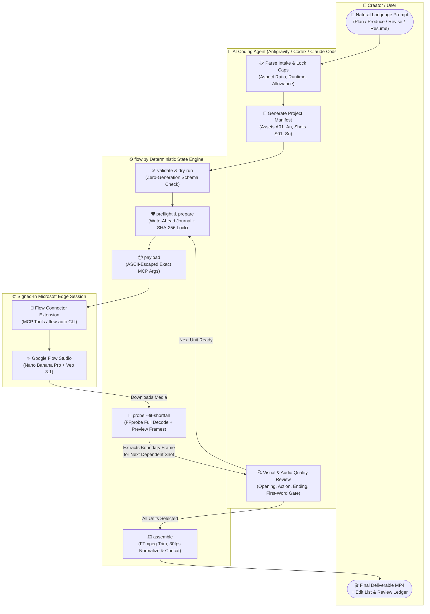
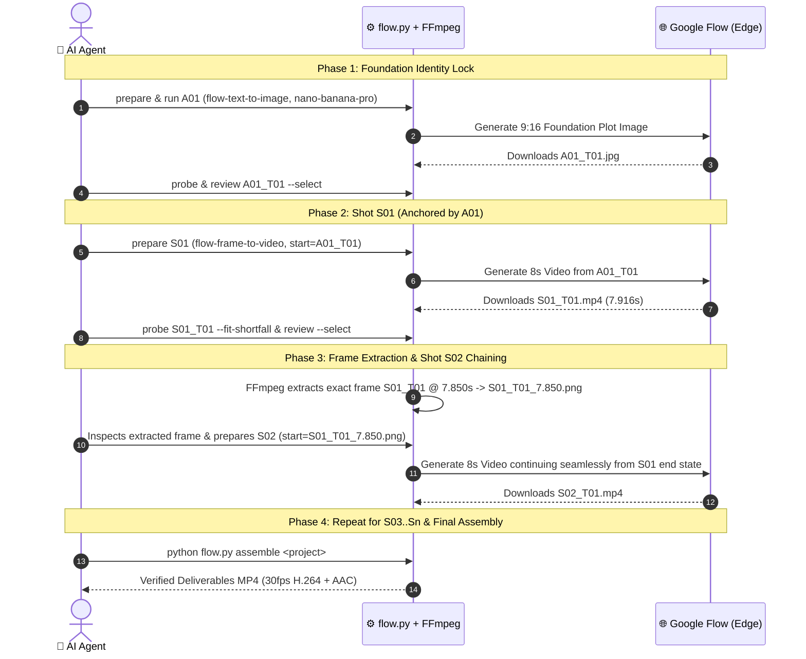
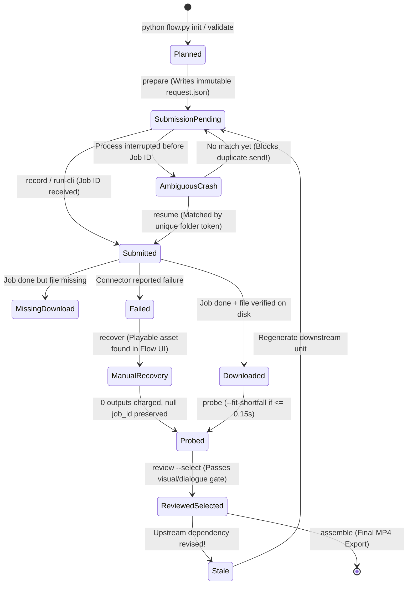

<div align="center">

```text
╔══════════════════════════════════════════════════════════════════════════════════════════╗
║  ░░░░░░░░░░░░░░░░░░░░░░░░░░░░░░░░░░░░░░░░░░░░░░░░░░░░░░░░░░░░░░░░░░░░░░░░░░░░░░░░░░░░░░  ║
║  ░░  ▄▄▄       ███▄    █ ▄▄▄█████▓ ██▓  ▄████  ██▀███   ▄▄▄    ██▒   █▓ ██▓▄▄▄█████▓ ░░  ║
║  ░░ ▒████▄     ██ ▀█   █ ▓  ██▒ ▓▒▓██▒ ██▒ ▀█▒▓██ ▒ ██▒▒████▄ ▓██░   █▒▓██▒▓  ██▒ ▓▒ ░░  ║
║  ░░ ▒██  ▀█▄  ▓██  ▀█ ██▒▒ ▓██░ ▒░▒██▒▒██░▄▄▄░▓██ ░▄█ ▒▒██  ▀█▄▓██  █▒░▒██▒▒ ▓██░ ▒░ ░░  ║
║  ░░ ░██▄▄▄▄██ ▓██▒  ▐▌██▒░ ▓██▓ ░ ░██░░▓█  ██▓▓██▀▀█▄  ░██▄▄▄▄██▒██ █░░░██░░ ▓██▓ ░  ░░  ║
║  ░░  ▓█   ▓██▒▒██░   ▓██░  ▒██▒ ░ ░██░░▒▓███▀▒░██▓ ▒██▒ ▓█   ▓██▒▒▀█░  ░██░  ▒██▒ ░  ░░  ║
║  ░░  ▒▒   ▓▒█░░ ▒░   ▒ ▒   ▒ ░░   ░▓   ░▒   ▒ ░ ▒▓ ░▒▓░ ▒▒   ▓▒█░░ ▐░  ░▓    ▒ ░░    ░░  ║
║  ░░       ×  C O D E X  ×  C L A U D E   C O D E  ×  G O O G L E   F L O W           ░░  ║
║  ░░░░░░░░░░░░░░░░░░░░░░░░░░░░░░░░░░░░░░░░░░░░░░░░░░░░░░░░░░░░░░░░░░░░░░░░░░░░░░░░░░░░░░  ║
║  🎬  A U T O N O M O U S   A I   F I L M   &   V I D E O   P R O D U C T I O N   O S     ║
╚══════════════════════════════════════════════════════════════════════════════════════════╝
```

# 🎬 Google Antigravity / Codex / Claude Code + Google Flow
### **Full Video Creation Automation — Zero API Keys, Frame-Exact Chaining & Crash-Safe Production**

[](#)
[-ec4899?style=for-the-badge&logo=google&logoColor=white)](#)
[](#)
[](#)
[-f59e0b?style=for-the-badge&logo=microsoftedge&logoColor=white)](#)

---

**Turn your AI coding agent into a full-scale Film Director, Continuity Supervisor, and Post-Production Editor.**  
Describe your video in plain English. Your agent writes the screenplay, locks visual identity, journals every generation to disk before dispatch, drives your signed-in **Google Flow** session in Microsoft Edge via MCP or CLI, extracts millisecond-accurate boundary frames for seamless transitions, inspects every take, and assembles the final broadcast-ready `.mp4` via FFmpeg.

</div>

---

## ⚡ Why People Hook Into This Repo

Most "AI video scripts" fire blind prompts at paid APIs, burn credits on duplicate retries when a socket drops, and stitch mismatched clips together with jarring jump cuts. **This workspace is engineered like a deterministic database transaction log for cinema:**

| Superpower | How It Works Under the Hood |
| :--- | :--- |
| 🔑 **Zero Paid API Keys** | Generates directly through your signed-in **Microsoft Edge Google Flow session** via `flow-connector` MCP tools or the `flow-auto` CLI fallback. |
| 🔗 **Sub-Frame Seamless Chaining** | Automatically extracts the exact final frame (`e.g. 7.850s`) of Shot $N$ via FFmpeg and feeds it as the locked start-frame of Shot $N+1$ (`flow-frame-to-video`). |
| 🛡️ **Write-Ahead Journal (No Double Spend)** | Every take is cryptographically hashed and journaled as `submission_pending` *before* calling Flow. If a crash happens mid-flight, `resume` reconciles against browser downloads instead of re-spending credits. |
| 🗣️ **First-Word Speaker Lock** | Solves multi-character lip-sync bleed: compiles a `0.4s` silent pre-roll, explicit speaker/listener visual anchors, and a `0.6s` closed-mouth hold into the prompt—backed by a mandatory playback verification gate. |
| 🩹 **Zero-Cost Asset Recovery** | When a browser extension reports a false timeout/failure even though Google Flow finished rendering the clip, `flow.py recover` ingests and hashes the asset at **0 credit cost** without inventing fake job IDs. |
| 🎞️ **0.15s Editorial Shortfall Fit** | Veo 3.1 nominal `8.0s` clips often decode at `7.916s`. `probe --fit-shortfall` automatically journals a clean editorial trim without re-generating or cutting off speech. |

---

## 🕹️ Pixel Studio Pipeline Overview

```text
  +-----------------------------------------------------------------------------------+
  |  [USER PROMPT]  "Build a 30s 9:16 hyperrealistic construction time-lapse..."      |
  +-----------------------------------------+-----------------------------------------+
                                            |
                                            v
  +===================================================================================+
  |  🧠 AI PRODUCER AGENT  (Google Antigravity / OpenAI Codex / Claude Code)          |
  |  +-- 1. Writes Brief, Continuity Sheet, Shot Plan & Manifest JSON                 |
  |  +-- 2. Validates Model Constraints & Dry-Runs Exact Payloads (0 Credits Spent)   |
  +=========================================+=========================================+
                                            |
         +----------------------------------+----------------------------------+
         |  python flow.py prepare          |  python flow.py payload          |
         v                                  v                                  |
  +------------------------------+   +------------------------------+          |
  | 📓 WRITE-AHEAD LEDGER        |   | 🔒 ASCII-SAFE JSON EXPORT    |          |
  | takes/S01_T01/request.json   |   | SHA-256 verified, preserves  |          |
  | State: submission_pending    |   | Devanagari, Hinglish & quotes|          |
  +--------------+---------------+   +--------------+---------------+          |
                 |                                  |                          |
                 +-----------------+----------------+                          |
                                   |                                           |
                                   v                                           |
  +=========================================================================+  |
  |  🌐 MICROSOFT EDGE  +  FLOW CONNECTOR BRIDGE  (MCP  /  flow-auto CLI)   |  |
  |  +-------------------------------------------------------------------+  |  |
  |  | 🎨 Imagen / Nano Banana Pro     🎥 Veo 3.1 Fast / Quality / Omni  |  |  |
  |  | [A01] Foundation Keyframe  -->  [S01..S04] Frame-Chained 720p MP4 |  |  |
  |  +-------------------------------------------------------------------+  |  |
  +====================================+====================================+  |
                                       |                                       |
                                       v                                       |
  +=========================================================================+  |
  |  🎞️ LOCAL FFPROBE + FFMPEG ENGINE (flow.py)                             |  |
  |  +-- Full stream decode & 3-point preview extraction (Open/Mid/End)     |  |
  |  +-- Extracts exact outgoing frame (e.g. S01 @ 7.850s) for next shot ---+--+
  |  +-- Agent visually inspects & selects take (`flow.py review --select`) |
  |  +-- Normalizes 30fps CFR + 48kHz AAC & concatenates final deliverable! |
  +=========================================================================+
```

---

## 🗺️ System Architecture & Flowcharts

### 1. End-to-End Agentic Production Loop



---

### 2. Zero-Jump-Cut Frame-Chaining Architecture

How a single foundation image evolves into a multi-shot time-lapse or continuous narrative where **the last frame of Shot $N$ is the exact first frame of Shot $N+1$**:



---

### 3. Write-Ahead Journal & Crash-Safe State Machine

Never lose track of an in-flight generation or accidentally double-bill your allowance:



---

## 🎯 What You Can Build With This Workflow

```text
┌────────────────────────────────────┬────────────────────────────────────┬────────────────────────────────────┐
│ 🏗️ TIME-LAPSE & ARCHITECTURE       │ 🗣️ MULTI-CHARACTER DIALOGUE        │ 📦 PRODUCT & COMMERCIAL REELS      │
├────────────────────────────────────┼────────────────────────────────────┼────────────────────────────────────┤
│ • Empty plot -> finished building  │ • 2+ characters in Hinglish/English│ • Tactile studio product reveals   │
│ • Single foundation image (A01)    │ • 0.4s silent lead-in guard        │ • `flow-ingredients-to-video`      │
│ • Frame-chained transitions        │ • 0.6s closed-mouth ending hold    │ • Strict silhouette & lighting lock│
│ • Consistent AI crew & machinery   │ • First-word ownership verification│ • Sample-accurate trimmed cuts     │
└────────────────────────────────────┴────────────────────────────────────┴────────────────────────────────────┘
```

---

## 🚀 Quickstart: Start in a Chat

Open this repository in **Google Antigravity**, **OpenAI Codex**, or **Claude Code**, make sure **Google Flow** is open in **Microsoft Edge** with the **Flow Connector** side panel visible, and drop any of the four core entry prompts into chat:

### 1️⃣ Plan a Video (Zero Generation / Zero Spend)
> **Prompt:**  
> *"Plan a video about a ceramicist revealing a finished blue cup. Make it 15 seconds, vertical 9:16, quiet and tactile. Estimate outputs and show the shot plan without generating."*

### 2️⃣ Produce a Complete Video End-to-End
> **Prompt:**  
> *"Produce a hyperrealistic 9:16 vertical construction time-lapse video (around 30 seconds, 720p) starting from an empty 21,000 sq.ft walled plot and evolving step-by-step into a finished industrial cold-storage facility. Use a single foundation image and chain the last frame of each shot into the first frame of the next shot for seamless transitions. Include subtle instrumental jazz with realistic construction foley. Use my open Google Flow project and assemble the final MP4."*

### 3️⃣ Revise a Specific Shot (Automatic Downstream Stale Tracking)
> **Prompt:**  
> *"Revise shot S02 in my-film: make the camera push-in half as strong and keep lighting unchanged. Stay within the remaining cap."*

### 4️⃣ Resume After a Browser or Terminal Interruption
> **Prompt:**  
> *"Resume project my-film. Reconcile the saved submissions with connector jobs and downloads before continuing unfinished work within the recorded limits."*

---

## 🛠️ PowerShell CLI Reference (`flow.py`)

`flow.py` uses **100% Python Standard Library** (Python 3.12+) plus your host's installed `node`, `flow-auto`, `ffmpeg`, and `ffprobe`.

### Step 1: Verify Test Suite & Initialize a Project
```powershell
# Run the 48 zero-Flow-generation unit & regression tests
python -m unittest discover -s tests -v

# Inspect CLI commands
python flow.py --help

# Initialize a new project in projects/my-film/
python flow.py init my-film --title "My Film"

# Validate the manifest and generate exact dry-run payloads (0 generations)
python flow.py validate my-film
python flow.py dry-run my-film
```

### Step 2: Preflight & MCP Generation Protocol
```powershell
# Check if current preflight is valid or within 2 minutes of its 15-minute expiry
python flow.py preflight-check my-film

# Record visible Edge project URL, resolution & side-panel observation
python flow.py preflight my-film `
  --url "https://flow.google.com/project/YOUR-PROJECT-UUID" `
  --source agent_ui `
  --evidence "Signed-in Edge visible, project open, 9:16 720p selected, Flow Connector panel open" `
  --status-file "projects/my-film/status.json"

# Write-ahead journal the take before sending
python flow.py prepare my-film A01 --transport mcp --status-file "projects/my-film/status.json"

# Export the exact ASCII-escaped MCP JSON payload (prevents Windows stdout Unicode corruption)
python flow.py payload my-film A01_T01
```

### Step 3: Record, Probe, Fit Shortfall & Select
```powershell
# Record the raw MCP response
python flow.py record my-film A01_T01 --response "projects/my-film/response.json"

# Probe & decode media (use --fit-shortfall on video clips for <= 0.15s stream duration differences)
python flow.py probe my-film A01_T01
python flow.py probe my-film S01_T01 --fit-shortfall

# Record concrete visual/playback review evidence and select the take
python flow.py review my-film A01_T01 --evidence-file "projects/my-film/review.json" --select
```

### Step 4: CLI Fallback, Zero-Cost Recovery & Final Assembly
```powershell
# If MCP is unavailable, execute directly via the native Node CLI fallback (shell=False)
python flow.py run-cli my-film S01
python flow.py resume my-film --cli

# Recover a playable clip from the browser if the connector falsely reported a failure (spends 0 outputs)
python flow.py recover my-film S04 `
  --file "projects/my-film/downloads/existing-clip.mp4" `
  --provenance-file "projects/my-film/recovery-source.json"

# Trim, normalize (30fps H.264 + 48kHz AAC), concatenate, and verify the final master MP4
python flow.py assemble my-film
```

---

## 📂 Repository Blueprint

```text
├── AGENTS.md                                  # Core agent operating rules & 4 chat entry points
├── README.md                                  # Architecture diagrams, quickstart & CLI guide
├── flow.py                                    # Zero-dependency Python production journal & runner
├── 0. General_Best Practices for Workflows/   # Agentic coding & workflow reference guides
│   ├── CLAUDE.md
│   ├── CODEXBESTPRACTICES.md.txt
│   ├── EXAMPLES.md
│   └── README.md
├── templates/                                 # Reusable project schemas & contracts
│   ├── manifest.json                          # Project, authorization, asset & shot ledger schema
│   ├── dialogue-shot.json                     # Sole-speaker turn, 0.4s lead-in & 0.6s hold contract
│   ├── review.json                            # Visual, continuity & first-word playback check template
│   ├── recovery-provenance.json               # Provenance schema for zero-cost recovered browser clips
│   ├── video-intake.md                        # Structured intake questionnaire
│   ├── brief.md                               # Creative brief template
│   ├── continuity.md                          # Visual/character continuity sheet template
│   └── edit-list.md                           # Editorial cut & trim sheet template
├── docs/                                      # Deep-dive engineering & production docs
│   ├── PRODUCTION.md                          # Full agent execution, review, revision & recovery manual
│   ├── VIDEO_RECIPE.md                        # Step-by-step recipe for dialogue & foundation-image films
│   ├── CAPABILITIES.md                        # Verified MCP / CLI operation matrix & model limits
│   ├── LESSONS_LEARNED.md                     # Real-world findings: speaker guards, Unicode, shortfall fit
│   ├── ACCEPTANCE.md                          # 48-test verification report
│   ├── FILES.md                               # Complete file inventory
│   └── discovery/                             # Captured CLI help, MCP tool schemas & test logs
└── tests/                                     # 100% offline mock-connector & FFmpeg test suite
    ├── test_workflow.py                       # Crash/resume, idempotency & FFmpeg assembly tests
    ├── test_lessons.py                        # Dialogue guard, Unicode stdout & recovery regressions
    └── fixtures/ceramicist-plan.json          # Frozen dry-run planning fixture
```

> **🔒 Privacy & Clean Repo Guarantee:**  
> Active production folders (`projects/<slug>/`), local reference media, and credentials (`.env`, `*.key`, `*secret*`) are strictly excluded via `.gitignore` so your personal characters, local downloads, and session data never leave your machine.

---

<div align="center">

**Built for autonomous filmmaking with Google Antigravity, OpenAI Codex, Claude Code & Google Flow.**  
*Star ⭐ this repo if you love turning natural language into frame-accurate cinema!*

</div>
